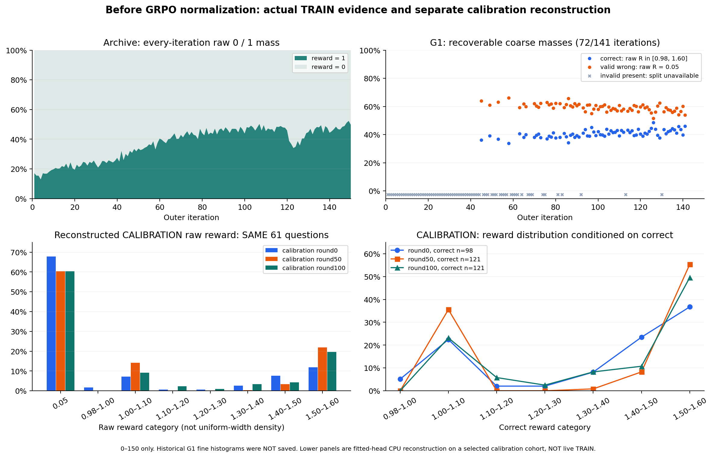
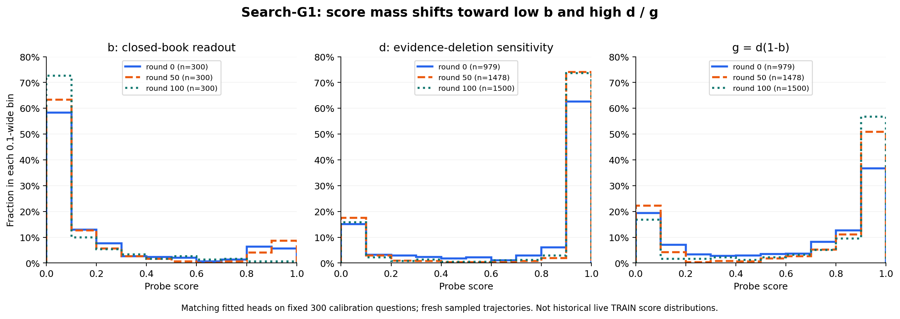
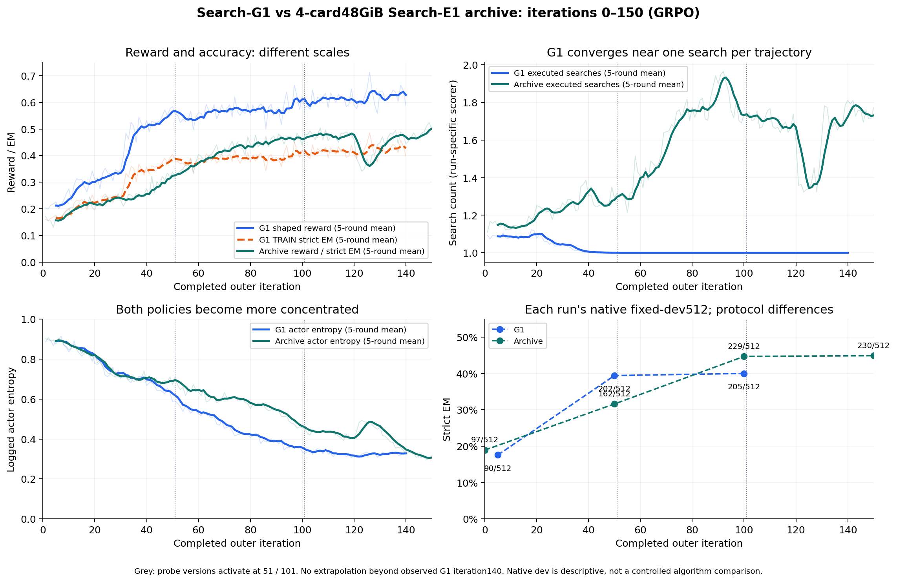

# Search-G1 的 b/d、奖励与 archive 四卡基线：实际训练证据

分析日期：2026-10-10。按最新人工要求，**只分析0–150轮**。此次仅做只读远端核验和 CPU 聚合，没有更改训练、探针、采样或路由。图中 G1 曲线固定到已完成140轮，之后尚未产出部分留空；archive 展示首轮 GRPO 的前150轮，尚未进入 OPSD。

## 已经能够回答什么

最新人工进一步要求优先考察**每轮归一化前的逐轨迹 reward 分布，并保留同题五条的分组**。此run实际是512×5=2560条/轮，不能按512×4误记。全局reward均值、b/d边际分布和归一化后的优势不是这个分布的替代品。

## 优先结果：归一化前的 reward 分布

**G1历史 TRAIN 没有持久保存每轮2560个原始R**：已现场核对绑定的trace生成源码、已保存字段和更新日志。行为记录有group UID/token/旧策略概率，没有逐条reward/b/d/advantage。均值、min/max不足以逆推出完整直方图或同题联合分布。不能凭“当时每轮有2560条”就宣称2560个R现在仍可读取。

Archive每条R只有0或1，因此其归一化前的边际分布可在日志精度上恢复：\(P_t=(1-p_t)\delta_0+p_t\delta_1\)，\(p_t=\texttt{critic/rewards/mean}\)。1/50/100/150轮的R=1占比分别约17.2%/33.8%/43.9%/49.8%；其余质量位于0。每轮均值只打印三位小数，计数须保留候选范围，不能伪造精确每条R。

G1的实际R分支是无效−0.1、有效错答0.05、正确[0.98,1.6]。141个已完成轮中72轮min=0.05，可确认这些轮没有−0.1无效结果：约1−EM质量在0.05，其余在[0.98,1.6]；正确区间内部形状仍未知。其余69轮存在无效结果，却不能从均值拆开−0.1和0.05质量。对于没有无效结果的轮，\(\mu_{correct}=0.05+(\bar R-0.05)/p_{correct}\)，舍入区间由EM±0.0005001传播，不是统计置信区间。例如100轮约57.9%在0.05、42.1%在正确区间，正确条件均值约1.406。

为了实际观察连续R形状，已在远端CPU将保存的校准features、匹配head、严格EM和**模型发出的search标签数**重新结合，按冻结原公式计算R。校准三点完整五轨迹组覆盖为62/300、281/300、300/300；缺失未搜索或无效轨迹不能虚构。使用三点共同完整的61题（各305条、同题但重新生成轨迹）比较如下：

| 同61道校准题，标准化前 | 0轮保存点 | 50轮保存点 | 100轮保存点 |
|---|---:|---:|---:|
| 正确轨迹 | 98/305 | 121/305 | 121/305 |
| R=0.05占比 | 67.87% | 60.33% | 60.33% |
| R在1.5–1.6的占比 | 11.80% | 21.97% | 19.67% |
| 原始R均值 | 0.46891 | 0.57222 | 0.58067 |
| 原始R总体标准差 | 0.62163 | 0.66296 | 0.67017 |
| 正确轨迹的R均值 | 1.35374 | 1.36633 | 1.38765 |
| 平均同题组内R样本标准差 | 0.17611 | 0.15593 | 0.20099 |
| 同题R恒定的组数 | 34/61 | 30/61 | 26/61 |

**50→100在这个共同题子集中正确轨迹数量未增加，reward却仍升高；增加来自正确轨迹的加成。** 同时，最高奖励区间质量并非单调增加：1.5–1.6从21.97%降至19.67%。因此应考察完整形状及同组差异，不能以均值或d高分占比单独描述。这是拟合内校准重构，三次学生轨迹/encoder/head都变化；不能外推为全512题训练分布或学生能力的因果提升。

100保存点完整300组/1500条：920条R=0.05，580条正确R位于[1.000+,1.599923]；median=0.05、p75=1.30436、p95=1.59151。147个全错组R恒定；79个全对组都出现非零组内R方差。相同轨迹若使用纯0/1奖励，全对组会是恒奖。混合组有1条正确轨迹低于同组平均R，而共同61题里没有出现这一情况。它说明奖励改动确实增加“答对轨迹之间”的相对监督，不证明这种排序改善验证EM。

所有字段、直方图和组分母见 `raw-reward-distributions.json`、`group-calibration.json`。先前将实际检索调用次数用于成本的重构v1另存且未验收；最终使用与原reward一致的model-authored search计数。两者在三个保存点分别有9/1/0条差异，不能混同。

**校准样本上 b 的预测向低分集中，d 和 d(1-b) 向高分集中；训练 reward 持续增长，搜索行为趋近每题一次。固定512验证50→100只新增3题正确。不能把这几件事合并解释成“越来越懂得何时搜索、越来越正确地使用证据”。**

历史 TRAIN 的逐轨迹 b/d 没有在已核对的奖励/探针/更新记录中完整持久化。此次在 G1 节点 CPU 上读取已保存的三个校准 NPZ 和匹配的 fitted head，重算直方图、分位数、条件均值。没有重新采样模型，没有把 NPZ、模型或原始轨迹搬到 Mac。这是**校准样本上的拟合内预测**，不冒充逐轮训练全集的分布，也不是独立测试集的概率校准。

## 为什么组内奖励是关键

实际 GRPO 对同题五条轨迹的终局奖励使用样本标准差：

\[
\bar R=\frac15\sum_iR_i,\quad s_R=\sqrt{\frac14\sum_i(R_i-\bar R)^2},\quad
A_i=\frac{R_i-\bar R}{s_R+10^{-6}}.
\]

若同组所有奖励做共同正仿射变换 \(R'_i=aR_i+c,a>0\)，优势近似不变。非恒奖组的 \(\sum A_i^2=4[s_R/(s_R+10^{-6})]^2\) 通常约为4。因此 reward均值上涨、组内方差变大，都不自动意味着更强的优势尺度；应看**非零组比例、组内排名、正确轨迹的优势符号和有效token加权**。

archive 的二值正确奖励中，k条正确（1≤k≤4）时：

\[
A_{correct}\simeq\sqrt{\frac{4(5-k)}{5k}},\qquad
A_{wrong}\simeq-\sqrt{\frac{4k}{5(5-k)}}.
\]

全对和全错组的 GRPO 策略优势都是0；额外KL项仍可作用，不能说总梯度为0。G1的区别在于：

- 五条全对仍可产生组内排序。如果都搜索、成本相同、同题b相同，\(R_i=1+0.6(1-b)d_i\)，得到 \(A_i=0.6(1-b)(d_i-\bar d)/[0.6(1-b)s_d+10^{-6}]\)。远离epsilon时，b及共同奖励尺度被标准化抵消，主要是d的组内排序驱动更新。
- 混合组中正确也不保证正优势。纯数学示例（不是观测）：\([1,1.6,1.6,1.6,0.05]\)均值1.17，第一条虽正确却低于均值、获负优势；它与另外三条正确轨迹的相对偏好被改变。
- 当前五条有效错答都记0.05，仍是零优势；五条无效都记−0.1也为零。有效错答/非法输出混合组有格式偏好信号，但不等于增加答对信号。

这些优势仍广播到该轨迹的有效推理、搜索动作和答案token；检索observation作为上下文、通过mask排除。不是逐搜索动作的独立价值估计。

archive前150轮未保存可完整还原的逐条reward+group UID批次；原stage只有训练日志及检查点，没有完整rollout输出。全部metric-key核查也没有组内std/全对/全错组占比。逐轮优势最大/最小约±1.789只说明存在极值组，不能推出组的数量；token加权advantage mean也不能代替等轨迹group均值。**不能从总体EM反推出同题五条组分布，不能假设五条独立而用p^5替代实测。**

## 两个探针如何变化

同一300道保留题的 question ID 集合 SHA 一致；每阶段新采样五条轨迹，并重新选择 encoder/readout。b 对300题等权；d/g 对具有合法上下文且实际执行过检索的轨迹统计，分母随阶段变化。

| 校准阶段 | 0轮 | 50轮 | 100轮 |
|---|---:|---:|---:|
| b 均值 | 0.20725 | 0.18962 | 0.11248 |
| b 中位数 | 0.07419 | 0.04725 | 0.02892 |
| b<0.1 | 175/300（58.33%） | 190/300（63.33%） | 218/300（72.67%） |
| 实际闭卷严格答对 | 36/300 | 38/300 | 40/300 |
| d 均值 | 0.74006 | 0.77562 | 0.78753 |
| d 中位数 | 0.96794 | 0.99292 | 0.99071 |
| d>0.9 | 613/979（62.61%） | 1095/1478（74.09%） | 1104/1500（73.60%） |
| 实际删除证据后发生答案变化标签 | 717/979 | 1147/1478 | 1177/1500 |
| g=d(1-b) 均值（逐条计算后平均） | 0.61413 | 0.67154 | 0.72701 |
| 正确轨迹的 g 均值 | 0.50087 | 0.56268 | 0.61014 |
| 错误轨迹的 g 均值 | 0.66611 | 0.72993 | 0.80070 |
| b：question-grouped CV AUC | 0.76322 | 0.73440 | 0.80288 |
| d：question-grouped CV AUC | 0.88972 | 0.82952 | 0.79877 |

**b 下降首先是一个读出分数变化，不能直接解释为闭卷能力下降。** 实际闭卷答对36→40，而且 b 的模型从 LR/layer24 换到 LR/layer27，再换到 MLP64/layer27。AUC 衡量有限的排序能力，不证明输出数值是校准后的真实正确概率。

额外只读 CPU 交叉诊断进一步说明不能沿版本直接比较分值：同300题的100轮表征交给0轮/50轮/100轮的 b head，均值得到0.85375/0.00266/0.11248。非对角项是跨表征、跨版本的诊断评分，没有用于实际训练奖励，也不是有效的因果贡献分解。完整3×3矩阵在 `boundary-cross-heads.json`。

**d 上升也不等于正确证据使用增加。** d 的监督是删除真实检索文本后答案是否变化，原答案错误同样可以获得高 d。删除后丢失可用答案也算变化：三个阶段分别有5、0、1条反事实无效答案。这个数量不足以单独解释全部变化，但必须保留定义。三个阶段错误轨迹的 g 均值始终高于正确轨迹；当前实现用正确性分支门控，错误轨迹不会因此得到正确搜索加成。

**不能用两个边际均值相乘来计算 g。** 同一联合样本上，

\[
\mathbb E[d(1-b)]=\mathbb E[d](1-\mathbb E[b])-\operatorname{Cov}(d,b).
\]

表中 b 的300题分母和 d 的轨迹分母也不同，因此报告使用实际逐轨迹 g，而非将两列均值相乘。

## 奖励变化的数学含义

当前部署的正确搜索奖励为

\[
R=1+0.6d(1-b)-0.02\mathbf1[N_{search}>1],
\]

正确直接回答为 \(1+0.5b\)，协议有效但答错为0.05，无效输出为−0.1。这里搜索计数取模型发出的有效范围内search标签数，成本是多于一次的指示惩罚，不是每次真实检索调用的线性成本。

假设两种行动都答对，奖励对搜索的偏好差值为

\[
\Delta R=0.6d(1-b)-0.5b-0.02\mathbf1[N_{search}>1].
\]

b 分数降低会同时减小直接回答的加成、增大搜索加成；d 增大也会提高搜索加成。这是奖励函数本身的数学作用，不证明这些预测准确刻画了搜索必要性。对校准中正确的检索轨迹，忽略搜索成本的平均奖励为1.3005→1.3376→1.3661；这是明确的校准样本项，NPZ 没有实际搜索次数，因此不能据此复原完整校准奖励。

| G1 训练窗口 | TRAIN 严格 EM（日志约值） | 实际 reward 均值 | 实际搜索/轨迹（日志约值） | actor entropy |
|---|---:|---:|---:|---:|
| 1–10 | 17.26% | 0.22370 | 1.0875 | 0.88256 |
| 41–50 | 37.04% | 0.54236 | 1.0015 | 0.64612 |
| 91–100 | 40.53% | 0.59401 | 1.0000 | 0.36148 |
| 131–140 | 42.72% | 0.62769 | 1.0000 | 0.32949 |

reward/entropy 使用原始 actual-updates 数值；EM/search 来自三位小数 console，搜索列取 `env/actual_retrieval_calls/mean`，不是另一个 `train/cost/search_per_query` 解析指标（其1–10轮均值为1.1383）。显示0.000的无搜索/多搜索比例不等于独立核实的零条。140轮实际检索调用总数为2560，均值1；单凭总数仍不能证明每条都恰好一次。换版发生在51/101轮开始训练，不能将跨版变化全部归因学生学习。

日志的 trust@correct 约0.7来自另一套时序监控：当前 ECO_USE_CF=0，正确搜索答案位于最后信息段后时记0.7。**trust 不是 d，也不是 g。** 不能用它补缺失的历史 probe 曲线。

## 与历史四卡48GiB Search-E1 archive 对比

archive 的 reward 基本就是严格 EM，未收集 b/d，不能给它填0或假造探针分布。50/100/150轮原生512结果分别为162/229/230题；G1 为202/205题（50/100轮）。archive 整数由每源256题的三位小数 binary mean 唯一反推，G1 计数由直接验证身份记录读取，证据精度不同。

| 保存轮次 | G1 native512 | Archive native512 |
|---|---:|---:|
| 50 | 202/512，39.4531% | 162/512，31.6406% |
| 100 | 205/512，40.0391% | 229/512，44.7266% |
| 150 | 尚未产出 | 230/512，44.9219% |

两组从同一个官方 Qwen2.5-3B-Instruct revision 开始，实际规范化题目集合与顺序也同为512题（有序SHA `b8557f89a232e9f0cf4532222e679ceb141d0d398ed4d9ca91906cf67355bbe6`）；题目+来源+规范化 gold 别名的有序SHA `b59bc0fed1409d04e9418e6a0a3f715005a8ba78325ece650bc28297b53910af` 也一致。但不是只改奖励的严格对照：archive 使用轨迹内 token 均值后等轨迹均值、reference KL0.001、普通 PPO clip；G1 使用原 two-row micro 内 pooled-token mean、reference KL0、DualClip3及额外数值保护。两组 entropy 系数实际均为0。训练样本划分、实现、提示、硬件和检索部署也须区分。两组原生验证均为 vLLM greedy，4096 prompt/2048 start/500 response/500 observation、4轮允许搜索加最后禁搜索轮、top3；不能混入后来 OPSD 的 HF/8192/obs480/repetition1.05验证。

本报告不展开150轮之后的事件。历史原训练进程已退出且有人工停止保留 receipt，未恢复该作业。

## 解释与下一项有效对照

当前支持“更集中地执行一次搜索、读出分数更倾向给予搜索加成”；不足以证明“搜索必要性识别更准确”。G1固定512的50→100只增加3题，训练 shaped reward却继续提高，已经说明 reward曲线不能替代效果曲线。d 的拟合内高分集中及 CV AUC下降值得关注，但不构成奖励作弊的证明。

若要分开策略学习与探针更换，应保留**同一题/同一轨迹下旧新 head 双评分、真实闭卷标签、删证据结果、正确性与搜索次数**，按正确/错误和搜索/直接回答分别统计。以后增加完整训练分布日志需单独实现并发布，不能在本次只读分析中热改正在运行的代码。

## 身份与可复查证据

- G1 节点：`job-20e13974-c420-4074-a464-68e93738cfc0-master-0`；目录 `/data/shaoshitong/Search-G1-a800-fresh200-a20f0475ec824c69ba1554f39e9ff512`；run `db474b6abf654ad9892b02ae67ab6f86`；source `fe59dc164490098054879141d5421e0b418b4056`。
- 当前奖励源码 `main_ppo_eco.py` SHA `bc0ac16ea7b4d671bc7d8c80b6525a9b467b41fdc92cbb097e7e3beaa00a285d`，现场文件与run manifest相同；先前别的源码快照不替代本次绑定。
- 三个校准 version/dump/head 的实际 SHA，以及相同题集 SHA，完整见 `calibration-distributions.json`；重算明确 `cpu_only=true`、`torch_imported=false`。
- Archive HKUST4目录 `/weka_3/shaoshitong/search-e1-config-study-20261004`；run `f04fe593830c4831918ede872812c016`；checkpoint50/100/150位于 `runs/archive/round-1-grpo/actor/global_step_{50,100,150}`。没有200结果。
- 两次 archive 实测10:54:12/10:54:54，原训练/控制PID均不存在；停止receipt SHA `6fd6a4af1e3c44e902f515e833a4e99d221946633a370c6f48579390b78d8eea`。
- 本地只保留小型聚合、源码、图和审计；原始校准 features、模型、训练日志与轨迹留远端。`chart-data.json`/`build-input-manifest.json`记录绘图数值与输入SHA。
