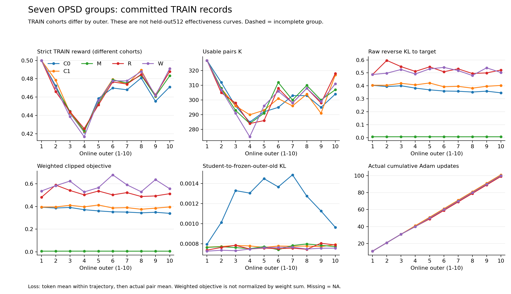

# 五组十轮训练记录与剩余验收（2026-10-09）

已完成 C0、C1、M、R、W 各十个在线 outer，共 50/70 outer、500 次真实 Adam、15,115 次可用 pair 曝光、2,947,399 个有效 policy token。P/J 各十轮尚未完成。这里更新训练记录和证据整理，不将整个七组消融标为完成。

新曲线使用已接受的同一次 50-outer producer facts，未重新训练、采样、评分、读取 Adam tensor 或调用 GPU。70 个槽全部列出，P/J 的二十个槽留空。每个 outer 使用不同的共同 TRAIN cohort，因此图中的 reward 是更新前采样的训练表现，不是固定 512 题验证曲线。

## 实际预算及目标值

以下 loss 为先有效 token 均值、再实际 pair 均值；跨 outer 以实际 K 加权。W 的 weighted objective 除以实际 pair 数，不除以权重和。

| 组 | 完成 outer | Adam | pair 曝光 | 有效 token | raw reverse KL 到本组目标 | weighted clipped objective | student→outer-old KL |
| --- | ---: | ---: | ---: | ---: | ---: | ---: | ---: |
| C0 | 10 | 100 | 3,012 | 583,074 | 0.372648 | 0.363949 | 0.001206 |
| C1 | 10 | 101 | 3,023 | 629,099 | 0.402636 | 0.394040 | 0.000777 |
| M | 10 | 100 | 3,032 | 637,380 | 0.006582 | 0.006582 | 0.000771 |
| R | 10 | 99 | 3,030 | 547,564 | 0.524301 | 0.515907 | 0.000765 |
| W | 10 | 100 | 3,018 | 550,282 | 0.511340 | 0.582270 | 0.000750 |

M 的目标为 0.1 teacher + 0.9 frozen outer-old 的概率混合，其他四组直接以 teacher 为目标；因此 M 的小 loss 不能解释为比其他组学得更好。其 student→teacher raw KL 为 0.403637。W 的实际 weighted pair 曝光为 3,030.562981，raw pair 曝光为 3,018；其目标值也不能与 R 无加权目标直接当作效果排序。

## 当前能够得出的结论

1. C0 的 raw loss 从 outer1 的 0.403615 降至 outer10 的 0.345832，但完整 BF16 native512 只有 227/512，低于共同零更新的 239/512。此对照再次说明优化固定轨迹分布的 loss 下降，不足以证明实际答题改善。它不能单独定位退化机制。
2. C0 的记录内平均 student→outer-old KL 为 0.001206，C1 为 0.000777。较大学习率组伴随较大的局部漂移，但各组后续在线轨迹、可用 K 和实际 Adam 数不同，不能把这张训练图当成单因素因果证明，也不是从 source100 累积至末点的全局漂移。
3. 五组 reward 都在第四个共同 cohort 降低，再回升。由于换题且每组的 student 已不同，这个共同波动不应被直接叫作第四轮训练崩溃。
4. R 的完整 native512 为 240/512，仅比共同 BF16 零更新多一题。已完成的同题 bootstrap 区间覆盖零；不能宣布随机配对已稳定提升。W 的最终成绩尚不能从训练 reward 或 weighted loss 推断。

## W 的逐 token 与教师诊断

W 的十轮真实训练记录已核对 100 个 committed update、3,018 条轨迹和全部 550,282 个有效 token。1,114 个 token 位置命中分量上裁剪，占 0.202442%；合计 1,116 个词表分量被裁。命中位置的平均 student 概率质量为 0.853374，teacher 为 0.000003675；这是条件在少量命中位置上的无加权统计，不是所有训练位置的质量，也不是最终答案正确概率。它显示裁剪集中在 student 与 teacher 强烈不一致的局部位置；是否影响效果仍缺对照，不能由这些记录认定因果。

全部有效位置的 scalar loss 保留，top32 保存 81,920 个位置，其余 468,362 个位置仅保存标量；top32 不能重建完整 KL。预选的两个完整词表位置共有八个 FP32 NPY、4,862,976 字节，实际 shape/有限性/成员 SHA 与预选关系通过。此处未重算 logits、梯度或完整分布归一化，也未宣布整个 study 的 24GiB 账本闭合。

八十个自主 teacher 案例独立于训练和验证分母。首次后处理明确缺十份外部 wait 原字节；随后单次 SFTP 补取 17,096 字节、逐份 size/SHA 匹配，再仅重跑必要的 teacher terminal 检查。十份原始 wait0 的 PID/UID/starttick/run/config 均通过。release 仍是历史父进程嵌入的 all-owned-release 证明，不是重新执行的实时释放扫描。原缺件记录保留，token/debug 核验没有重跑。

安全聚合见 [W 十轮 debug 摘要](../reports/W10-recorded-token-debug-20261009/scientific-summary-complete.safe.json)。原始 token、生成轨迹、HTTP 和八个 NPY 仍在私有已验收归档及 HKUST 原目录，不入 Git。

## 固定验证的边界

截至 2026-10-09 16:46:34 CST，六个模型已完整评估，共 3,072/5,632 个正式预测；W 的同一八 worker 评估完成 189/512，全部 RUNNING，原 driver/控制器/PID/UID/starttick 匹配。该部分不计算 EM。P 的 child-start/status 尚未出现，保持原 driver 在 W 评估后接续 P/J，不将本地分析、备份或 Git 设为启动门禁。

| 已完整评估模型 | 总正确 / 512 | NQ / 256 | Hotpot / 256 |
| --- | ---: | ---: | ---: |
| 共同 BF16 零更新 | 239 | 110 | 129 |
| 共同 FP16 零更新 | 245 | 111 | 134 |
| C0 BF16 raw10 | 227 | 109 | 118 |
| C1 BF16 raw10 | 236 | 109 | 127 |
| M BF16 raw10 | 237 | 109 | 128 |
| R BF16 raw10 | 240 | 110 | 130 |

FP16 零更新是部署精度对照，不能以其 245 减 BF16 的 239 来认定训练收益。P/J 仍须分别完成共同 BF16 与 FP16 部署评估。完整交付仍需全部 70 outer、11 个模型各 512、18 个比较/54 个分层、完整 debug/恢复资产/持久副本和中文结论。

## 来源与产物

- 原始 50-outer facts：`work/search-e1-analysis-output/opsd-ablation-execution-20261008/goal-continuation-20261009-37/W-closed10-163146/facts.stdout.json`，SHA256 `e8f3d3348294a4f0848cac998d0427a1eb4ab15076a479623a3e5e7f97573066`。
- 使用既有已发布 formatter `control/opsd_ablation_recorded_curves_v1/derive.py`，SHA256 `b41944178bfda97514cf3179c5651d350fa97a552e3af9b48b5162d718e69583`；实际运行退出 0，未增加科学测试。
- [70 槽 CSV](../reports/seven-group-recorded50-outers-progress-20261009/seven-group-70-slots.csv)、[分组摘要](../reports/seven-group-recorded50-outers-progress-20261009/seven-group-recorded-summary.json)、[SVG](../reports/seven-group-recorded50-outers-progress-20261009/seven-group-recorded-curves.svg)、[产物清单](../reports/seven-group-recorded50-outers-progress-20261009/derived-manifest.json)。PNG 已视觉检查六个面板、图例及边界说明，无可见截断或文字重叠。
- 训练源码仍为原 `871dc46f`，dtype 修复为 `538ac99a`，评估为 `72e1e127`；本报告提交不是新部署训练版本。私有原题、HTTP、轨迹、token 和权重未纳入 Git。
