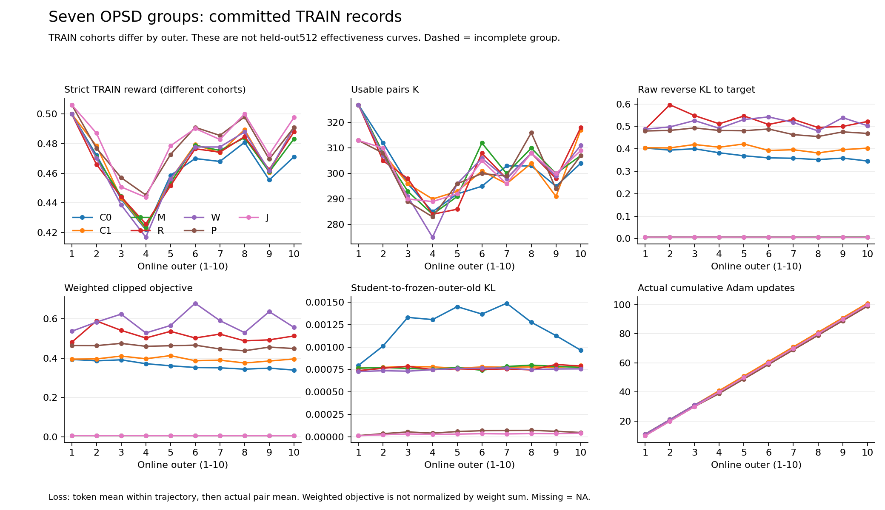

# 七组 OPSD：70 轮训练后的 CPU 数值与 debug 验收

七组各 10 个 online outer 已完成，累计 **699 次真实 Adam 更新、21,132 次配对曝光、4,060,515 个有效 token**。新增独立 CPU 检查已关闭全词表存储账本，并完整核对 P/J 的已记录精度和训练尝试历史。这里验收的是数值记录与资产覆盖；截至本报告固定快照，J 的 BF16/FP16 正式评测尚未全部验收，不能称整个七组效果实验完成。

| 组 | outer | Adam | 配对曝光 | 有效 token |
| --- | ---: | ---: | ---: | ---: |
| C0 | 10 | 100 | 3,012 | 583,074 |
| C1 | 10 | 101 | 3,023 | 629,099 |
| M | 10 | 100 | 3,032 | 637,380 |
| R | 10 | 99 | 3,030 | 547,564 |
| W | 10 | 100 | 3,018 | 550,282 |
| P | 10 | 99 | 3,005 | 585,132 |
| J | 10 | 100 | 3,012 | 527,984 |

这些计数来自同一份已关闭原生记录。各组实际 K 不同，因而 Adam 和样本曝光也不同；W/J 的加权曝光另为 3,030.562981 和 3,021.390012，不能把原始配对数直接当作加权训练预算。

## 新关闭的两个缺口

**全词表账本已完整关闭。** 物理文件与已提交快照一致：56 个数组、14 个完整 reservation、14 个保存位置，合计 34,040,832 字节（约 34.04 MB），低于共同 24 GiB 上限。未提交残留、悬空额度、reserved capacity 和 pending reason 均为 0，cap skip 为 0。收集器与消费器实际返回码均为 0，原科学源码未改变。物理文件清单/SHA 和先前有限性检查是不同证据：这次账本核对不重新证明分布归一化、KL、梯度或 GPU 恢复能力。

**P/J 的已记录尝试与精度历史完整。** 每组都有 10 个训练 attempt、80 份八 rank 精度记录和 10 个实际训练终态，未缺文件、没有非零训练终态或未提交更新票据。P 提交 99 次、J 提交 100 次 Adam；两组已记录的 retry、跨 invocation retry 和保留的 gradient overflow 均为 0。同步 scaler 的已记录 scale 保持 65,536。

安装记录钩子的模块输出均为 FP16：P 共 9,223,644 次观测，J 共 9,233,940 次。各组详细事件保存 327,680 条，其余 8,895,964 / 8,906,260 条只在汇总计数中保留。这个结论限于这些模块的输入/输出，不能扩成“全部 kernel、activation、归一化和 log-softmax 都用 FP16”。FP32 参数、梯度主副本与 Adam 状态由单独的最终 checkpoint 数值实读支持；本历史报告没有重新加载恢复胶囊中的 RNG/optimizer tensor。

每组 80 份明确引用的 dtype 修复回执也已核对，但没有宣称完整遍历所有外部历史回执。Mac 与 HKUST 时钟未校准，报告保留原时间，只检查各主机内部顺序和实际返回码/身份/SHA；不从跨主机时间差推导绝对因果顺序。

## 曲线能解释什么

[公开 CSV](../reports/final-cpu-debug-20261009/seven-group-70-slots.csv) 和[曲线图](../reports/final-cpu-debug-20261009/seven-group-recorded-curves.png)覆盖全部 70 个 outer，包含 TRAIN strict reward、K、原始目标 KL、加权裁剪目标、相对冻结 outer-old 的 KL 及累计 Adam。

横轴各轮来自不同的 TRAIN cohort，不是固定 heldout 512 的学习曲线。M/J 的目标混入 90% outer-old，其较低目标 loss 不能直接解释为优于纯 teacher 目标；附带汇总分别保留 teacher KL 和相对 old 的漂移。W/J 的加权目标与等轨迹均值也分开记录。loss、clip 或漂移的下降不能替代同题 EM，也不足以单独证明哪个改动修复了退化。

## 已保留的 debug 与存储边界

全部 4,060,515 个有效 token 的原生标量记录已核对有限性、mask、顺序、实际尾批分母与 loss 重构。另有 573,440 个位置保存 top32，余下 3,487,075 个位置只有标量；top32 不足以重建全词表 KL。56 个完整数组覆盖每组预先选择的两个位置、每位置四份 FP32 分布，并非每个 token 都有完整词表 dump。

七组各 80 个独立 teacher 自主生成案例共 560 个，属于诊断，未进入 TRAIN/验证分母。学生每组 25,600 条原生轨迹、80 份 generation trace 和 80 份 HTTP trace 的源 SHA 已持久绑定；这里不声称重新语义解析全部原始文本。早先 coverage 检查仅核 parent 内嵌退出证据，外部 teacher/sampler phase terminal 的逐文件独立核对仍由另一项验收负责。

C0/C1/M/R/W/P 的独立 HKUST 副本为 25,390 文件 / 14,912,586,127 字节，J 为 4,225 文件 / 2,394,956,643 字节，合计 **29,615 文件 / 17,307,542,770 字节**。两批均有实际传输返回码 0、源/目标完整文件 SHA 与元数据连续性证据。这些是同节点独立 inode 副本，不是异地灾备；checkpoint payload 不在这个 raw copy 范围内，受保护 checkpoint 原件另留 HKUST。Mac/Git 仅保留本报告、代码、公开聚合、图和小型身份摘要，未拉回 tensor、原题或全量预测。

旧 `coverage-derived-manifest.json` 中 `shared_24GiB_ledger_complete=false` 与 `all70_debug_coverage_complete=false` 是当时快照。本报告附带原字节，不把旧时点改写成已通过；新 ledger 的 COMPLETE 来自下列独立后续执行。最终 11×512 预测、J 两种部署效果、外部 phase、driver 实际成功终态和完整评测资产持久化仍要分别关闭。

## 可复核来源

HKUST 主目录为 `/data/shaoshitong/search-e1-opsd-ablation-archive100-8gpu-20261008`。

| 实际证据 | HKUST 绝对路径 | SHA256 |
| --- | --- | --- |
| 全70原生事实 | `/data/shaoshitong/search-e1-opsd-ablation-archive100-8gpu-20261008/analysis/remote-seven-debug-1791557910/seven-debug-audit/facts.private.json` | `2682eec7f76153a5d27f44dd863a8923a51ca3482d1d8a3014b131ac3e098487` |
| 三类 debug reader 完成 | `/data/shaoshitong/search-e1-opsd-ablation-archive100-8gpu-20261008/analysis/remote-seven-debug-1791557910/seven-debug-audit/complete.json` | `17e16f318cbe2480173445c91ab925dc30b39b48217bbe1f16c56ea6bdba3d17` |
| 后续 ledger 执行完成 | `/data/shaoshitong/search-e1-opsd-ablation-archive100-8gpu-20261008/analysis/remote-final-audits-v2-1791559800/ledger-closed/complete.private.json` | `aded91aea89f7593f3f9ad961010a0b6528e25088042579df28042e7d8dfeb0a` |
| P/J precision summary | `/data/shaoshitong/search-e1-opsd-ablation-archive100-8gpu-20261008/analysis/remote-precision-v3-1791559870/precision-history/summary.json` | `adf7c6b5cb9e931f36bd1acd6c305242466577cef22117f4245b64ac1e3e987f` |
| P/J precision 派生清单 | `/data/shaoshitong/search-e1-opsd-ablation-archive100-8gpu-20261008/analysis/remote-precision-v3-1791559870/precision-history/derivation-manifest.json` | `b415459263b31f99c041cc1cfa7889826d5a047f707b75fe316ea51f17342034` |
| 70轮曲线派生清单 | `/data/shaoshitong/search-e1-opsd-ablation-archive100-8gpu-20261008/analysis/remote-all70-curves-1791560000/public-curves/derived-manifest.json` | `7621f00c62b1fda8c08403a96467a50f5b3e988db929cdbc12c3734160eaa5a0` |

公开副本的逐文件 bytes/SHA 见[本包清单](../reports/final-cpu-debug-20261009/manifest.json)。账本消费器源码 SHA 为 `0123b06b13c6abb0554d0a825bb1a28565f192e0b046ef878feda4af35f8a2a0`；精度历史 v3 为 `ec69e80e458483afcab28fce9c4f11d455903e9d7ae3164093eb5128667b68c4`；曲线派生器为 `b41944178bfda97514cf3179c5651d350fa97a552e3af9b48b5162d718e69583`。这些 CPU 辅助版本不改变训练 871dc46、dtype 538ac99 或评测 72e1e12 的科学实现。
