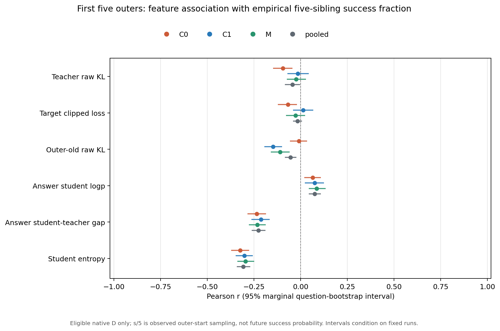
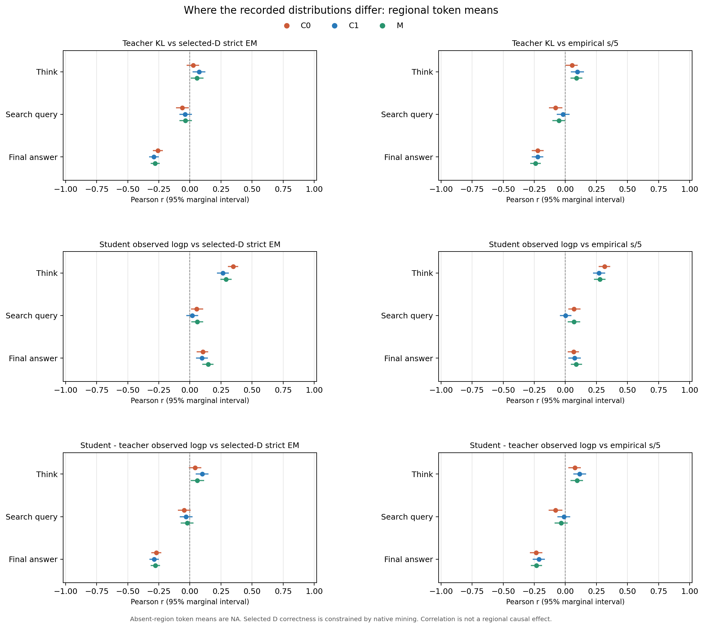
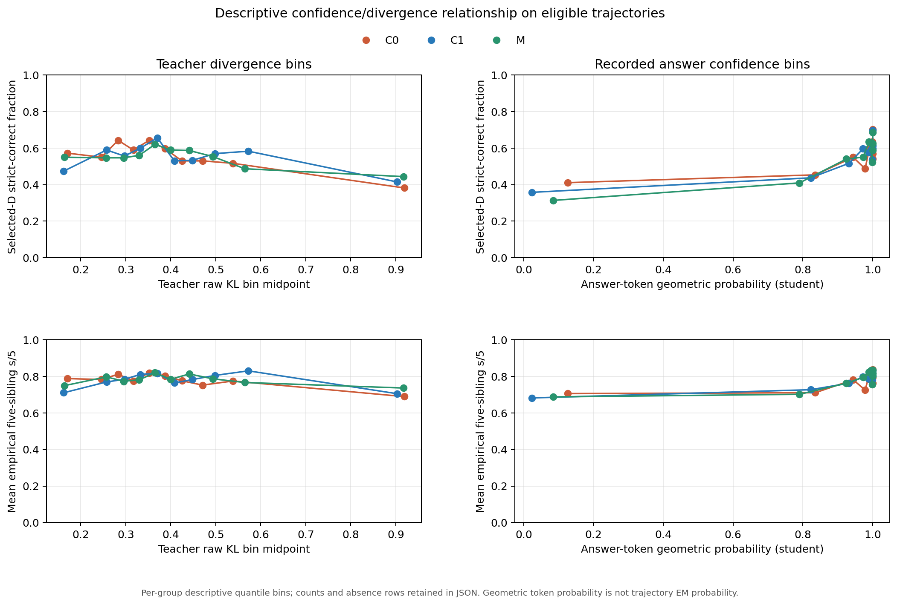
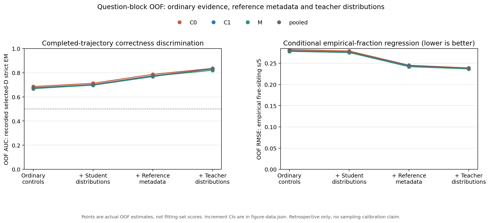

# C0/C1/M前五轮：最终正确性与loss、概率的实测关系

这次分析以**最终strict EM和同题五次采样的成功比例**为终点。不是用loss区域占比代替效果，也不是重新制定一个等待执行的计划。前五轮实际数据已全量读取，统计和独立数值核验均完成；没有新增训练或改变正在运行的GPU队列。

主要发现：**整条轨迹的平均teacher KL不是有效的正确性指标；最终答案位置的teacher–student概率分歧包含更强的答案相关信息。student自己的答案token概率即使几乎为1，也不能当作答对概率。M的小loss主要来自目标改变，现有正式EM不证明它优于C1。**

## 1. 实际分析了什么

“前五轮”是outer 0–4，每轮512道TRAIN题、每题5条fresh自主轨迹，不是前五次Adam。三组同轮题目相同；共2,560个不同question_id，保留它们跨组的关联。

| 前五轮实测 | C0 | C1 | M |
| --- | ---: | ---: | ---: |
| TRAIN题数 | 2,560 | 2,560 | 2,560 |
| 实际采样轨迹 | 12,800 | 12,800 | 12,800 |
| 有实际训练loss的B/D对 | 1,512 | 1,514 | 1,503 |
| 真实Adam更新 | 50 | 51 | 50 |
| 有效训练token | 305,446 | 318,739 | 316,110 |
| 五次都失败、没有loss的题 | 1,048 | 1,046 | 1,057 |
| 全cohort五次采样的经验pass@1 | 45.906% | 46.008% | 45.844% |
| 全cohort observed pass@5 | 59.063% | 59.141% | 58.711% |

总计4,529对、940,295有效token、151次更新、7,680个group-question记录。所有有效token的原文件SHA、mask/offset、区域覆盖、原生轨迹loss和实际尾批分母重构通过。只读提取实际退出0；独立审计核对六个原生首/尾更新及全部聚合特征，误差在浮点精度内。

原始差别：C0为学习率5e-6、teacher目标；C1为1e-6、相同teacher目标；M为1e-6、概率混合目标`0.1 teacher + 0.9 outer-old student`。三组保留词表分量clip上限10及每轨迹先平均再对实际轨迹平均。teacher固定source100；outer-old每轮重置，不能把old KL称为相对source100的累计漂移。

## 2. 正确性标签及选择限制

本报告同时使用两个真实结果：

- **D最终strict EM**：被矿选学生自主生成结束后的0/1结果，重读冻结严格scorer；不是teacher-forcing概率或`termination=answer`。
- **s/5**：同题五条自主轨迹的正确比例，是temperature1下只有五次观测的经验成功比例，不是精确真实pass概率。

全量核实：4,529个pair中，`D正确 ⇔ 五条全部正确`，违反数为0。因为原mine优先选失败D，只有五条全对才从成功轨迹fallback选D。于是这里的EM判别是“全五条成功”与“仍有失败”的判别，**不是对随机学生轨迹的无偏EM分析**。

约41%的group-question五条全错，没有成功B，也没有teacher训练loss；它们保留在全cohort统计中，不能编造loss=0后参加关联。所有有loss的题observed pass@5恒为1，所以不能对它计算相关/AUC。下文loss关联及OOF仅针对有loss的矿选分布。

D和五条reward来自outer起始模型的自主生成；loss和logprob来自随后该pair实际训练前向，current可能已有轮内更新。这是完整轨迹的回顾性诊断，不是生成之前预测未来答对。

## 3. 哪个标量与正确性真正有关

每条轨迹等权，不把940,295个token当独立样本。`r`为Pearson，`ρ`为Spearman；95%区间用seed42、1,000次共同question分层bootstrap，保持跨组同题一起抽样。区间描述本次固定运行/样本，不代表独立训练seed方差；多指标区间不是家族同时置信区间。

下表AUC保留**原始“特征越大越正确”的方向**；低KL/低entropy/低gap作为正确方向时可取`1−AUC`，不是重新选择特征或拟合新模型。

| 全组三组汇总指标 | 与D EM的r | 与s/5的r（95%区间） | 与s/5的ρ | 原始方向EM AUC |
| --- | ---: | ---: | ---: | ---: |
| 全policy teacher reverse KL | −0.078 | −0.044 [−0.084, −0.002] | −0.039 | 0.466 |
| 实际target post loss | −0.021 | −0.016 [−0.040, +0.009] | −0.013 | 0.490 |
| 全policy outer-old KL | −0.063 | −0.053 [−0.084, −0.022] | −0.140 | 0.418 |
| 最终答案student平均logprob | +0.116 | +0.076 [+0.044, +0.109] | +0.144 | 0.590 |
| 最终答案`student logp − teacher logp` | −0.278 | −0.225 [−0.261, −0.188] | −0.469 | 0.213 |
| 全policy student平均entropy | −0.319 | −0.306 [−0.342, −0.268] | −0.314 | 0.319 |

答案gap不是绝对值，而是对实际D答案token的有符号`log p − log q`。gap越大，表示student相对teacher更确信自己输出的词。以负gap作为答案匹配分数，EM AUC为**0.787**；以负entropy作为低不确定性分数，AUC为0.681。teacher KL按“越低越正确”计AUC仅0.534，接近随机。

**普通student自身的信号中，整条policy entropy及think词的logprob比最终答案词的置信度更有关联；特权teacher信号中，最终答案处的分歧最有信息。**

不能用M和C1不同目标的post loss直接比较“谁更正确”。逐组的结果也显示loss关联弱，并非只因三组合并：

| 与s/5的Pearson r | C0 | C1 | M |
| --- | ---: | ---: | ---: |
| teacher KL | −0.094 | −0.014 | −0.024 |
| 本组实际post loss | −0.068 | +0.014 | −0.026 |
| student答案logprob | +0.066 | +0.075 | +0.086 |
| 答案student−teacher logp gap | −0.234 | −0.211 | −0.232 |
| student entropy | −0.324 | −0.301 | −0.294 |

C1 post loss与D EM的r仅−0.021，正确/错误均值0.39893/0.40499；M分别0.006589/0.006749，r为−0.034。**标量loss很小或继续下降，并不提供足够的答对信息。**

## 4. 具体是哪个位置，而不是哪个位置token最多

以下是区域内有效token均值，区别于区域占整条loss的贡献。think、search query、最终答案payload、结构tag、boundary等按原response offset和policy mask分配；information/forced等原来不参与loss的内容没有被纳入。

| 区域指标 | 与D EM的r | 与s/5的r | 与s/5的ρ |
| --- | ---: | ---: | ---: |
| think内部teacher KL | +0.053 | +0.080 | +0.078 |
| search query内部teacher KL | −0.045 | −0.049 | −0.045 |
| 最终答案内部teacher KL | **−0.276** | **−0.228** | **−0.351** |
| think内部student实际词logprob | +0.301 | +0.288 | +0.292 |
| search query内部student实际词logprob | +0.044 | +0.046 | +0.095 |
| 最终答案student实际词logprob | +0.116 | +0.076 | +0.144 |
| think内部student−teacher logp gap | +0.068 | +0.095 | +0.096 |
| search query内部student−teacher logp gap | −0.033 | −0.041 | −0.038 |
| 最终答案student−teacher logp gap | **−0.278** | **−0.225** | **−0.469** |

最终答案KL的正确/错误均值为**0.463/2.253**，差异明显；全policy KL却只有0.392/0.415。把不同区域混成一个均值后，答案相关的分歧被弱相关甚至相反方向的think分歧稀释。think teacher KL更低并不对应更高的本次成功比例，不能统一采用“全区域更接近teacher就更好”的解释。

更关键的是纳入已记录控制变量后的增量。以student分布加参考长度/search信息模型为基线，分别只加入该区域的teacher KL、logp gap和本组post loss：

| 新增区域分布指标 | 共同question五折OOF AUC | 相对基线ΔAUC（95%区间） |
| --- | ---: | ---: |
| 无新增：student＋参考元数据 | 0.7754 | — |
| think区域 | 0.7840 | +0.0086 [+0.0031, +0.0146] |
| search query区域 | 0.7751 | −0.0004 [−0.0023, +0.0017] |
| 最终答案区域 | **0.8195** | **+0.0441 [+0.0343, +0.0536]** |

答案增量在C0/C1/M分别+0.0329/+0.0571/+0.0420；search query增量三组都接近0且区间跨0。这支持**答案位置的分布指标更能诊断输出是否正确**。不支持“search不重要”，也不证明重加权答案loss会提高EM：区域指标不是区域参数梯度，这些模型也没有干预训练。

17条轨迹没有可独立分配到最终答案payload的有效token（C0/C1/M为6/4/7），其答案指标保留NA，其他指标仍参与。这17条有4条strict正确，不能把区域空缺一律当协议错误或logprob=0。

## 5. token概率高，是否就更容易答对

student答案logprob有弱正关联，但token概率和整题正确概率是不同对象。答案置信度定义为`exp(答案token平均logprob)`，即几何平均token概率，不是算术概率均值，也不是整个答案概率积。

三组汇总的最高答案置信度10%分箱，有452条轨迹，几何token概率全部至少约**0.999995**，但只有**303/452＝67.04%** strict正确，仍有149条答错；该箱平均s/5为82.21%。最低置信度10%是163/452＝36.06%正确。置信度有信息，但不能把0.999995解释为“99.9995%会答对”。矿选标签限制也继续适用，不能拿这个条件样本做总体概率校准。

teacher对实际D答案词的态度区分更大。为明确均值含义，下表是先对每条轨迹取平均logprob，再对同标签轨迹等权平均，最后取exp的**跨轨迹几何汇总**：

| 已生成D结果 | student答案词几何汇总 | teacher给同样D答案词的几何汇总 | 平均logp gap |
| --- | ---: | ---: | ---: |
| strict正确 | 约0.919 | 约0.608 | 0.413 |
| strict错误 | 约0.840 | 约0.071 | 2.467 |

teacher往往明显不赞同学生实际输出的错误答案词；student却仍给它们很高概率。答案gap最低10%分箱正确346/452＝76.55%、平均s/5为88.72%；gap最高10%只有65/452＝14.38%正确、平均s/5为59.42%。这比全policy KL的两端分箱更有区分：全KL最低/最高10%的平均s/5为75.41%/70.91%。

这是**固定D历史上的原始模型概率**，不是自主生成时经过repetition penalty/其他processor处理后的得分。teacher看过成功B，所以上述差异证明它的分布含有答案相关信息，不证明它在错误前缀上实际续写能纠错，也不证明student蒸馏后一定学会纠错。

## 6. 控制长度、搜索和参考之后，关系还剩多少

同question的三组记录严格放在同一fold，五折OOF；没有在训练fold和测试fold复制同题。训练折内插补/标准化，固定L2强度1。X不含s/5、CC/CW标签或最终EM。实际55个二元/fractional模型均收敛。

四级模型依次加入信息，成功B元数据单独列出，避免把参考信息误称student自身能力：

| 模型可用信息 | EM OOF AUC | EM Brier↓ | EM logloss↓ | s/5 OOF RMSE↓ | 预测与s/5的r |
| --- | ---: | ---: | ---: | ---: | ---: |
| 普通控制：group/outer/data source/D长度、search、轮内进度 | 0.6762 | 0.2228 | 0.6375 | 0.2799 | 0.2905 |
| 再加student普通分布：old KL、答案logp、entropy | 0.7026 | 0.2157 | 0.6209 | 0.2769 | 0.3226 |
| 再加成功B的长度、token数、search元数据 | 0.7754 | 0.1882 | 0.5540 | 0.2441 | 0.5509 |
| 再加teacher KL、本组post loss、答案logp gap | **0.8306** | **0.1647** | **0.5015** | **0.2379** | **0.5816** |

普通student分布带来ΔAUC **+0.0264**，区间[+0.0130,+0.0386]；参考元数据带来+0.0729；在这些信息之外teacher分布仍带来**+0.0551**，区间[+0.0431,+0.0678]。对s/5，teacher增量的RMSE变化为−0.00615，区间[−0.00883,−0.00360]。

因此相关性不全由长度/search解释，但**很大一部分判别信息来自成功参考本身**。这是成功参考条件下、完整D生成后的回顾性信息分析；OOF保证诊断统计模型的训练/测试折没有同题交叉，不会消除teacher本身的特权信息或矿选偏差。它不是未来pass概率估计器，也不反映一次训练更新的因果效应。

## 7. C0、C1、M究竟差在哪里

前五轮全policy teacher KL均值C0/C1/M为0.39035/0.41124/0.40516；实际post loss为0.38096/0.40166/**0.006661**。C0总体更接近teacher并没有带来更高的后续正式EM；M loss小约60倍也不能理解成更接近teacher。

为排除后续在线D不同，单独比较第一outer的**327个精确相同D、B、token/mask**，三项SHA匹配数327、失配0。在相同原历史上：

| 第一outer，右组减左组 | C1−C0（95%区间） | M−C1（95%区间） |
| --- | ---: | ---: |
| teacher KL | +0.001178 [+0.000485,+0.001800] | −0.000157 [−0.000717,+0.000459] |
| 本组post loss | +0.001276 [+0.000655,+0.001855] | **−0.387936 [−0.403469,−0.374408]** |
| outer-old KL | −0.0000287 [−0.0000477,−0.00000987] | −0.00000251 [−0.0000238,+0.0000184] |
| 答案student logprob | +0.000844 [−0.002706,+0.004125] | +0.000922 [−0.002385,+0.005251] |

M目标是`q_mix=0.1q_teacher+0.9p_outer_old`，实际优化`KL(p_current || q_mix)`。这是**概率混合**，不能改写成两个KL的线性加权和。old以轮起点student权重初始化，所以目标天然更靠近student。第一outer M大幅小loss的同时，teacher KL和答案概率没有同规模改善，直接说明loss尺度/目标变化，而不是60倍效果提升。

该比较是相同原D/B，但轮内训练路径和current状态不同；D结果都在更新前已生成，不能拿它做更新后的EM差值。不同组后四轮原D和资格可能不同，整体均值比较还有在线数据选择影响。

五轮逐轮检查也没有一个稳定的“全teacher KL越低，成功率越高”关系：C1每轮teacher KL与s/5的r是+0.022、+0.080、−0.037、−0.129、+0.004；M为+0.021、+0.040、+0.036、−0.134、−0.118。答案gap与s/5的Spearman却在全部15个group-outer都为负，范围约−0.396至−0.539；entropy与s/5的Pearson也全部为负。这里只证明诊断关联方向较稳定，不定位准确退化更新。

## 8. 真正heldout512结果是否呼应

已有正式评估是**十outer末**，不是前五轮评估。四模型同数据、普通greedy协议、source100身份、runtime及八逻辑rank设置；2,048条原native capture已fresh SHA核验。这些capture没有生成logprob/processed scores，不能伪造其逐题概率。

| 正式512 | 零更新baseline | C0十轮末 | C1十轮末 | M十轮末 |
| --- | ---: | ---: | ---: | ---: |
| 总正确 | 239 | 227 | 236 | 237 |
| EM | 46.680% | 44.336% | 46.094% | 46.289% |
| NQ正确/256 | 110 | 109 | 109 | 109 |
| Hotpot正确/256 | 129 | 118 | 127 | 128 |
| 相对baseline新增/丢失 | — | 20/32 | 13/16 | 13/15 |
| 相对baseline差值及原配对95%区间 | — | −2.344pp [−5.078,+0.391] | −0.586pp [−2.734,+1.367] | −0.391pp [−2.344,+1.563] |

C1到M是新增12、丢失11，净多1题，差值+0.195pp，区间[−1.758,+1.953]。**目前没有M胜过C1或改善baseline EM的可靠证据**；C0的点估计更差，也不要把跨0的区间写成已证明总体下降。

C0丢失32题中，C1仍答对22题，M仍答对23题，二者共同正确20题。C1保持的22题里15题与C0搜索次数一样；M保持的23题里16题一样。32题四模型最终行动都为合法answer，C0是gold mismatch。因而总体搜索减少不能解释全部损失；不是全由最终格式破坏造成。

实际前五轮TRAIN qid与正式512 qid交集为0，四字段semantic row SHA交集也为0；不同qid的问题文字是否重复未另作证明。**没有把TRAIN逐题loss错误拼到heldout EM上，也没有拿三个模型均值做三点相关拟合。**本次细粒度关系主要回答采样成功比例和已生成D正确性；正式512只作为独立效果证据。

## 9. 可以据此下什么结论

1. **“全轨迹KL/loss下降＝EM上升”没有得到支持。** pooled关系很弱，C1/M组内实际loss更接近零相关，M目标差异进一步破坏跨组loss可比性。
2. **teacher不是完全没有答案相关信号。** 最终答案处teacher对错误D词的概率明显更低，概率gap和答案KL的正确性关联、控制后增量都比全policy teacher KL更明显。但这不证明其自主纠错或蒸馏的效果。
3. **student自身置信度能提供有限诊断信息，不能当pass概率。** entropy/think logp比已输出答案词的置信度更有信息；极高答案token概率仍有大量错误。
4. **答案区域值得优先做后续因果对照，不能直接宣称应给更大loss权重。** 现有数据只有loss贡献和分布，不含逐token参数梯度，也没有每次更新前后同题独立重采样；区域AUC增量不是训练贡献比例。
5. **M目前更像目标尺度和约束机制改变，不是已证明的性能修复。** 要归因为混合约束改善效果，需要固定采样/曝光/训练预算的对照和独立效果评估；现有512净多1题不够。

本次结论与原先“teacher全面更差”“search次数是唯一根因”“loss下降越多越好”均不同。已完成的统计支持的是：**关注答案相关分歧及student不确定性，比关注一个全轨迹蒸馏loss更接近最终正确性；训练收益本身仍须用真实EM检验。**

## 10. 可复核产物与实现

- 实际只读提取：`work/search-e1-analysis-output/opsd-ablation-execution-20261008/em-loss-relation-20261009/extraction-attempt-0001/`；原始stdout、4,807项fresh输入清单及实际rc0保留。pair/cohort文件SHA分别`dd16fb008eb2cb4135db3a0b375cc0262c2a84764c86514b875da0a9c6b67f25`、`9e3307b671463ba958dffbefd53cbb58814028980b68d1c002c82eb6244c044e`。
- 实际统计：同目录下`stats-attempt-0001/`，summary SHA `ff896afaf4da3681b2b5cb1507c8dc34a2e62fd63185dc6d05b3f5711c53c913`；source SHA `b01d44d927cbdd0c539207da25b78cfcd8b008a97483e659c4534df08de8cf98`。OOF逐题预测保留私有，不入Git。
- [公开聚合统计](assets/opsd-first5-em-loss-20261009/aggregates.json)、[六主特征表](assets/opsd-first5-em-loss-20261009/univariate.csv)、[描述分箱](assets/opsd-first5-em-loss-20261009/descriptive-bins.csv)、四张PNG/SVG及figure-data。
- [方法协议](opsd-first5-em-loss-relation-protocol-20261009.md)、[提取说明](../control/opsd_first5_em_loss_analysis_v1/README-extraction.md)、[统计说明](../control/opsd_first5_em_loss_analysis_v1/README-stats.md)、[绘图说明](../control/opsd_first5_em_loss_analysis_v1/README-plots.md)。

独立提取验收SHA `447d376e49cbc17075b1f4911233550236f4ae2bcffb5216cab82f9bc058eb7a`；独立统计验收SHA `69195b7b5a284578a537e8481fafe4343aa0af1034a638f4cca48d43afd5f8b7`。统计审计独立重算主关联及OOF point metrics，最大误差4.44e−16；没有声称重复全部bootstrap/fit。

源码提取发布`3274888`、统计身份修正发布`aef1331`、绘图发布`9501fc0`都已推送search-e1并从FETCH_HEAD逐文件SHA读回。这些是独立分析源码版本，不是正在训练的science版本。原题、答案、trace、token、权重、凭据不入公开Git，HKUST原证据和本地私有成品保留。
