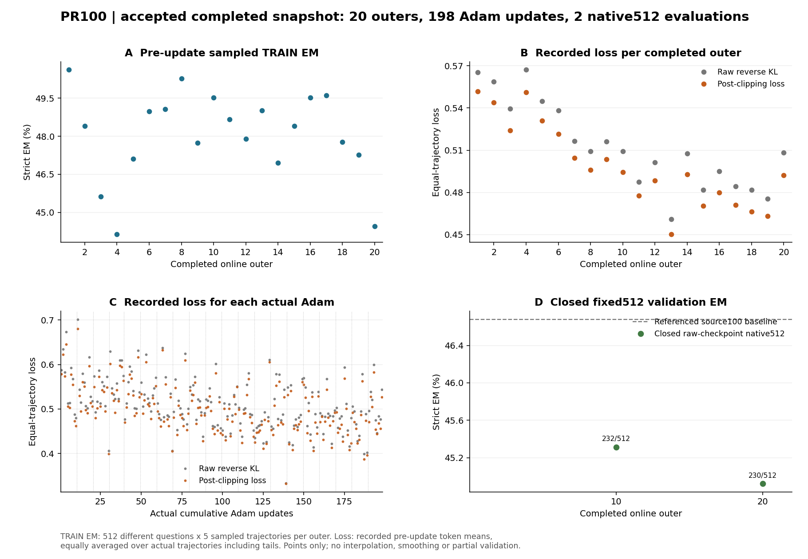

# C1 + P + R：第20轮完整512结果

**第20轮原始权重为230/512（44.921875%），尚未测到相对source100的EM提升。** 相同普通greedy协议的source100为239/512（46.679688%），第10轮为232/512（45.312500%）。第10到20轮的两个已测保存点净少2题（−0.390625个百分点）；这不确定两点之间在哪一步改变，也不提供两保存点之间的逐题新增/丢失。

| 同协议权重 | 真实累计Adam | 全512正确 | 全512 EM | NQ正确/256 | Hotpot正确/256 |
| --- | ---: | ---: | ---: | ---: | ---: |
| source100 | OPSD更新前 | 239 | 46.679688% | 110 | 129 |
| 第10轮raw | 99 | 232 | 45.312500% | 106 | 126 |
| 第20轮raw | 198 | 230 | 44.921875% | 107 | 123 |

第20轮相对source100新增14、丢失23、保留正确216、仍错259，净少9题（−1.7578125个百分点）。23条丢失全部为最终行动协议有效、答案不匹配gold；整个第20轮512结果有0条最终行动协议无效、282条协议有效但答错、0条未执行搜索，512条均answer终止。因此当前这部分退化不能概括为格式失效或不搜索。

按题配对bootstrap 10000次、seed42的第20轮差值95%区间为[−4.1015625, +0.5859375]个百分点，跨0；第10轮区间也跨0。两个固定保存点均低于本次真实source100计数，但不能据此认定总体统计确定下降，更不能单独归因为P精度修复或R随机选择。NQ第10→20轮增加1题，Hotpot减少3题，只是同条件已测逐集计数差。

## 训练与loss：20轮已经提交，100轮仍未完成

本次实际20个online outer完成**198次Adam、5947条可用配对曝光、966617个有效policy token**。每轮实际更新数为ceil(K/32)，真实尾批计入；第20轮K=282，实际9次更新，不能将20轮写成200次Adam。接下来的训练继续同一权重、Adam、RNG/scaler/cursor状态。

| outer | 更新前采样TRAIN正确/2560 | TRAIN EM | raw loss | clip后loss |
| --- | ---: | ---: | ---: | ---: |
| 1 | 1296 | 50.625000% | 0.565267 | 0.551606 |
| 10 | 1268 | 49.531250% | 0.509306 | 0.494466 |
| 20 | 1138 | 44.453125% | 0.508339 | 0.492069 |

20轮合计24603/51200条采样轨迹strict正确（48.052734%）。各轮使用不同的512道TRAIN题，每题5条轨迹，指标取该轮更新前采样，**不是固定验证曲线、pass@5或每次Adam后的EM**。loss是原训练前向实际记录：每条轨迹有效token平均后，再按实际配对平均；20轮曝光加权raw/clip后均值为0.512514/0.498756。loss较首轮降低而固定512尚无提升，只能说明目标值降低未同步带来已测EM提升，不能据此定位算法根因。

图仅含已提交20轮TRAIN、198次实际loss记录、完整闭合的10/20两个512点；不含部分预测，不插值、不平滑。完整逐轮TRAIN值与逐Adam loss分别见 `train-outer-curves.csv` 和 `committed-adam-loss.csv`。完整100轮和十次512交付仍在进行。

训练run `c6a79477161a4a059e4fd68fc7567f87`；固定训练配置SHA `651dfb40b1bf22fb5f604b9b17c45ffe8619f20baf521f399bc8059b11d6aa91`。第20轮raw checkpoint manifest SHA `3ec2f153288855ac351a65c7480a9adc1c5e8964a78013cccfe5c27a56f70c4f`。远端独立聚合目录：`/data/shaoshitong/search-e1-opsd-pr100-8gpu-20261010/analysis/first20-training-native512-20261010-0624-inspect`。只将小型聚合CSV、图与摘要保存在本机，原始轨迹、权重和优化器仍在HKUST。
