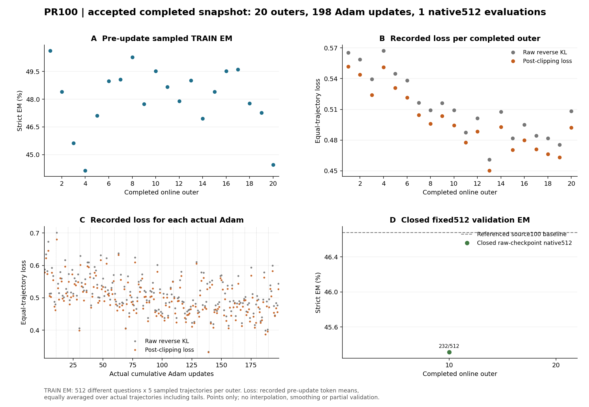

# C1 + P + R：前20轮训练与已闭合10轮验证

本次仅汇总已经提交的20个 online outer：**198次真实 Adam 更新、5947条可用配对曝光、966617个有效 policy token**。第20轮含282条配对，因此该轮是9次更新；outer轮数与 Adam 次数分开计数。完整100轮实验仍在进行。

| 已完成 outer | 本轮采样 TRAIN 正确/2560 | 采样 TRAIN EM | 实际累计 Adam | 记录 raw loss | 记录 clip 后 loss |
| --- | ---: | ---: | ---: | ---: | ---: |
| 1 | 1296 | 50.625000% | 10 | 0.565267 | 0.551606 |
| 10 | 1268 | 49.531250% | 99 | 0.509306 | 0.494466 |
| 20 | 1138 | 44.453125% | 198 | 0.508339 | 0.492069 |

20轮合计24603/51200条采样轨迹 strict 正确，采样 TRAIN EM 为48.052734%。各轮在44.140625%–50.625000%之间波动。**每轮是不同的512道TRAIN题、每题5条轨迹，指标取本轮更新前的采样结果**；它不是固定验证集曲线、pass@5，也不是每次 Adam 后的 EM。完整逐轮数值在 `train-outer-curves.csv`，198次实际更新的 loss 在 `committed-adam-loss.csv`。

记录 loss 按每条轨迹的有效token先平均，再按实际配对平均，包含真实尾批分母。第1到20轮的 clip 后 loss 从0.551606变为0.492069，raw从0.565267变为0.508339，中间有波动；全20轮按配对曝光加权的均值分别为0.498756和0.512514。这些是原训练前向实际记录的标量，不是新增模型重算或历史梯度重建。loss下降本身不能证明生成效果提升。

## 固定512题：目前只有第10轮已闭合

| 同协议权重 | 全部512 EM | NQ正确/256 | Hotpot正确/256 |
| --- | ---: | ---: | ---: |
| source100原始权重 | 239/512 = 46.679688% | 110 | 129 |
| 第10轮原始权重（Adam99） | 232/512 = 45.312500% | 106 | 126 |

同题新增10、丢失17、保留正确222、仍错263，净少7题（−1.367188个百分点）。17条丢失均为最终行动协议有效但答案不匹配gold；不是这17条的格式失效。按题配对 bootstrap 10000次、seed42的95%差值区间为[−3.320313, +0.585938]个百分点，跨0，不能据此认定总体统计确定下降或单因素因果。

**第20轮的512题评测尚未形成完整闭合结果，本报告和图均不纳入部分预测。** 图中固定验证只有第10轮一个实际点，未在10到20之间插值。等待第20轮全部512及真实退出/释放记录完成后，才能比较相同验证题的第二个保存点；不能从TRAIN第20轮的44.45%推断验证EM。

源训练run：`c6a79477161a4a059e4fd68fc7567f87`；原训练配置SHA：`651dfb40b1bf22fb5f604b9b17c45ffe8619f20baf521f399bc8059b11d6aa91`。本次远端聚合目录：`/data/shaoshitong/search-e1-opsd-pr100-8gpu-20261010/analysis/first20-training-closed10-native512-20261010-0518-inspect`。这里只保存小型聚合CSV、图与审计摘要；原始轨迹、模型和优化器仍在HKUST。
