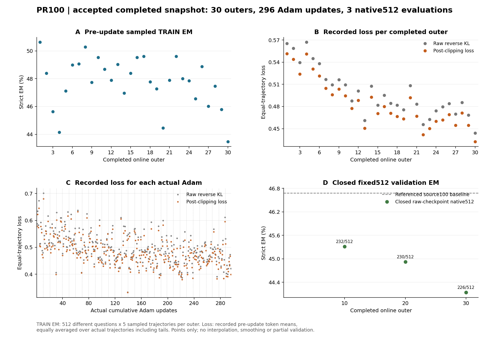

# C1 + P + R：第30轮完整512与训练曲线

**第30轮为226/512（44.140625%），目前三个保存点均未超过source100基线239/512。** 第10/20/30轮依次为232/230/226。第20→30轮净少4题（−0.78125个百分点），第10→30轮少6题（−1.171875个百分点）；这些仅是已测保存点的总数差，不是它们之间的逐题新增/丢失，也不能定位精确退化更新。

| 同协议原始权重 | 累计真实OPSD Adam | 固定512正确 | EM | NQ正确/256 | Hotpot正确/256 |
| --- | ---: | ---: | ---: | ---: | ---: |
| source100 | 0 | 239 | 46.679688% | 110 | 129 |
| 第10轮raw | 99 | 232 | 45.312500% | 106 | 126 |
| 第20轮raw | 198 | 230 | 44.921875% | 107 | 123 |
| 第30轮raw | 296 | 226 | 44.140625% | 102 | 124 |

验证均为固定NQ256+Hotpot256、普通提示greedy、同HF SDPA/BF16 base+FP32未merge原始adapter协议。第30轮八rank各64条正式预测，实际父进程wait0、完整释放及boundary accepted后才纳入本报告；额外控制生成不计512。

第30轮相对source100新增15、丢失28、保留正确211、仍错258，净少13题（−2.5390625个百分点）。28条丢失全部是最终行动协议有效但答案不匹配gold。全512有2条最终行动协议无效、284条协议有效但答错，0条未执行搜索。因此已丢失的28条不能归为格式失效或未搜索。

按题配对bootstrap 10000次、seed42的第30轮差值95%区间是[−5.078125, 0]个百分点：**区间仍包含0，上界恰为0**。第10/20轮区间也包含0。观测方向一直低于基线，但不能将其写成已证明总体统计确定下降或P/R单机制因果。

## 已提交30轮TRAIN与实际loss

30个online outer共**296次真实Adam、8888条可用配对曝光、1400256个有效policy token**。每轮Adam为ceil(K/32)，尾批真实计入；第30轮K269、9次更新，因此30轮不能写成300次Adam。完整100轮、十次512仍未完成。

| outer | 更新前采样TRAIN正确/2560 | TRAIN EM | 记录raw loss | 记录clip后loss |
| --- | ---: | ---: | ---: | ---: |
| 1 | 1296 | 50.625000% | 0.565267 | 0.551606 |
| 10 | 1268 | 49.531250% | 0.509306 | 0.494466 |
| 20 | 1138 | 44.453125% | 0.508339 | 0.492069 |
| 30 | 1113 | 43.476563% | 0.444164 | 0.432492 |

30轮采样strict正确合计36674/76800（47.752604%）。每轮是不同的512道TRAIN题、每题5轨迹，取本轮更新前采样；**它不是固定验证曲线、pass@5或每次Adam后的EM**。各轮TRAIN采样EM在43.476563%–50.625000%间波动。全部逐轮值在 `train-outer-curves.csv`，296次实际Adam的loss在 `committed-adam-loss.csv`。

loss是原训练前向实际记录的每轨迹有效token均值后实际配对均值，包含尾批分母；全30轮按配对曝光加权raw/clip后均值为0.498780/0.484774。第1→30轮loss降低而固定512未提高，说明记录目标值下降尚未转化为已测EM收益，不能据此单独定位算法、学习率或样本选择根因。这是标量汇总，未新增模型/梯度重算或训练消融。

图仅画已提交30轮TRAIN、296次实际loss及闭合10/20/30三个512点，不纳部分预测、不插值、不平滑。训练run `c6a79477161a4a059e4fd68fc7567f87`；配置SHA `651dfb40b1bf22fb5f604b9b17c45ffe8619f20baf521f399bc8059b11d6aa91`；第30轮raw checkpoint manifest SHA `5ad8f2cc2383d6010a12c91395e69eeb4d8c6d9a7627cf7d2a1ab4b9b90b65c3`。

远端聚合目录 `/data/shaoshitong/search-e1-opsd-pr100-8gpu-20261010/analysis/first30-training-native512-20261010-inspect`。本机只保留小型聚合CSV、图及摘要；原始轨迹、权重和优化器留HKUST。未修改生产配置、重跑已完成前缀或恢复旧实验。
